<!-- Assets in ./assets are generated by scripts/build_assets.py — edit there, then re-run. -->

<a href="https://fuewa.systems"></a>

<div align="center">

[](https://fuewa.systems)
[](https://mumcord.app)
[](https://github.com/ToBee94?tab=followers)
[](https://github.com/ToBee94)

</div>

<br/>

<a href="https://github.com/Mumcord/mumcord"></a>

<div align="center">

[](https://github.com/Mumcord/mumcord/releases/latest)
[](https://github.com/Mumcord/mumcord/releases)
[](https://github.com/Mumcord/mumcord/stargazers)
[](https://github.com/Mumcord/mumcord/commits)
[](https://github.com/Mumcord)

**[Download](https://github.com/Mumcord/mumcord/releases/latest)** &nbsp;·&nbsp; **[Website](https://mumcord.app)** &nbsp;·&nbsp; **[Wiki](https://github.com/Mumcord/mumcord/wiki)**

</div>

<p align="center">
  <a href="https://github.com/Mumcord/mumbot"></a>
  <a href="https://github.com/Mumcord/mumpeer"></a>
</p>

<br/>

## `$ cat about.php`

```php
<?php

final class Tobias
{
    public string $role     = 'Backend Engineer';
    public string $company  = 'fuewa.systems // Eventim Tech GmbH';
    public string $location = 'Bremen, Germany';

    public array $building = [
        'Mumcord'  => 'Modern voice chat for any Mumble server (Rust + Tauri)',
        'Shellock' => 'Multi-tenant SSH key management (Symfony + Docker)',
        'SDKs'     => 'Clean, typed API clients: ClouDNS, AC Infinity, WordPress',
        'Data'     => 'Open structured data for the grow community',
    ];

    public function askMeAbout(): array
    {
        return ['PHP', 'Symfony', 'Rust', 'Docker', 'API design', 'Mumble'];
    }
}
```

## `$ ls ~/open-source`

<sub>Everything listed on <a href="https://fuewa.systems/open-source">fuewa.systems/open-source</a>.</sub>

<p align="center">
  <a href="https://github.com/ToBee94/Shellock"></a>
  <a href="https://github.com/ToBee94/phpass"></a>
  <a href="https://github.com/ToBee94/cloudns-api-php"></a>
  <a href="https://github.com/ToBee94/ac-infinity-php"></a>
  <a href="https://github.com/Die-PARTEI-in-Europa/wordpress-api"></a>
  <a href="https://github.com/Die-PARTEI-in-Europa/headless-mode"></a>
  <a href="https://github.com/Die-PARTEI-in-Europa/block-manager"></a>
  <a href="https://github.com/Die-PARTEI-in-Europa/EU-Politics-CAPTCHA"></a>
  <a href="https://github.com/unserioes24/growdata-hub"></a>
</p>

## `$ which stack`

<p align="center">
  <a href="https://skillicons.dev"></a>
</p>

## `$ git log --graph`

<div align="center">


</div>

<br/>

<a href="https://fuewa.systems"></a>
