<!-- assets/ is generated by scripts/build_assets.py -->

<a href="https://fuewa.systems"><picture>
  <source media="(prefers-color-scheme: dark)" srcset="assets/header-dark.svg">
  
</picture></a>

<picture>
  <source media="(prefers-color-scheme: dark)" srcset="assets/s1-mumcord-dark.svg">
  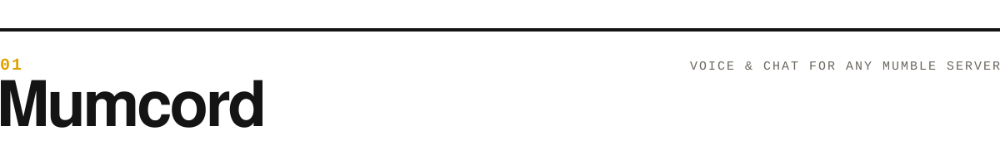
</picture>

<a href="https://github.com/Mumcord/mumcord"><picture>
  <source media="(prefers-color-scheme: dark)" srcset="https://raw.githubusercontent.com/Mumcord/mumcord/main/docs/images/screenshots/main-dark.png">
  
</picture></a>

A desktop client for any standard Mumble server: low-latency voice, chat you'd actually use, push-to-talk on mouse buttons, several servers at once, no telemetry. Rust + Tauri, on Windows, macOS and Linux.

&nbsp; **[mumcord.app](https://mumcord.app)** · **[Download](https://github.com/Mumcord/mumcord/releases/latest)** · **[Wiki](https://github.com/Mumcord/mumcord/wiki)**

  
  
  
  

  <a href="https://github.com/Mumcord/mumbot"><picture><source media="(prefers-color-scheme: dark)" srcset="assets/card-mumbot-dark.svg">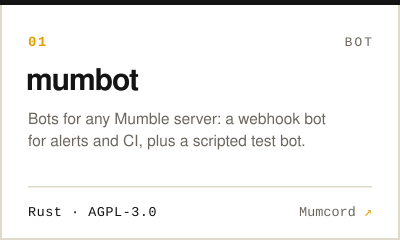</picture></a>
  <a href="https://github.com/Mumcord/mumpeer"><picture><source media="(prefers-color-scheme: dark)" srcset="assets/card-mumpeer-dark.svg">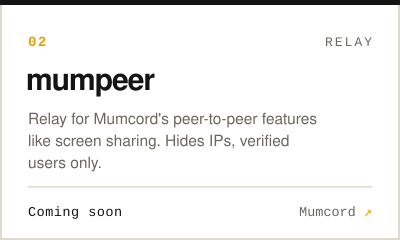</picture></a>

<picture>
  <source media="(prefers-color-scheme: dark)" srcset="assets/s2-open-source-dark.svg">
  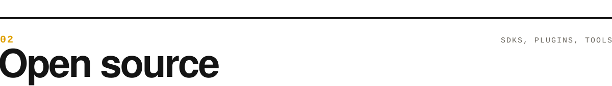
</picture>

  <a href="https://github.com/ToBee94/Shellock"><picture><source media="(prefers-color-scheme: dark)" srcset="assets/card-shellock-dark.svg">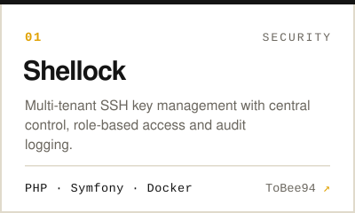</picture></a>
  <a href="https://github.com/ToBee94/cloudns-api-php"><picture><source media="(prefers-color-scheme: dark)" srcset="assets/card-cloudns-dark.svg">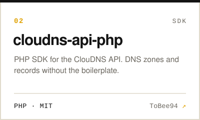</picture></a>
  <a href="https://github.com/ToBee94/ac-infinity-php"><picture><source media="(prefers-color-scheme: dark)" srcset="assets/card-acinfinity-dark.svg">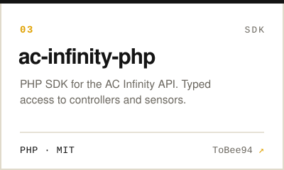</picture></a>
  <a href="https://github.com/ToBee94/phpass"><picture><source media="(prefers-color-scheme: dark)" srcset="assets/card-phpass-dark.svg">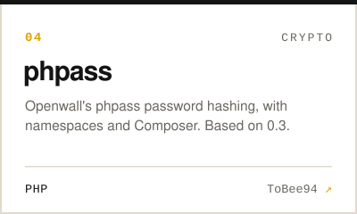</picture></a>
  <a href="https://github.com/unserioes24/growdata-hub"><picture><source media="(prefers-color-scheme: dark)" srcset="assets/card-growdata-hub-dark.svg">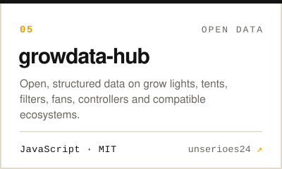</picture></a>
  <a href="https://github.com/Die-PARTEI-in-Europa/wordpress-api"><picture><source media="(prefers-color-scheme: dark)" srcset="assets/card-wordpress-api-dark.svg">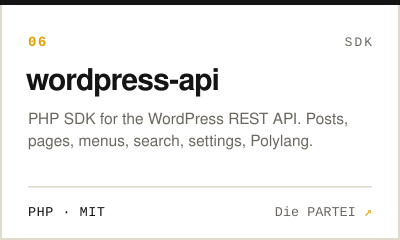</picture></a>
  <a href="https://github.com/Die-PARTEI-in-Europa/headless-mode"><picture><source media="(prefers-color-scheme: dark)" srcset="assets/card-headless-mode-dark.svg">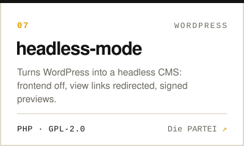</picture></a>
  <a href="https://github.com/Die-PARTEI-in-Europa/block-manager"><picture><source media="(prefers-color-scheme: dark)" srcset="assets/card-block-manager-dark.svg">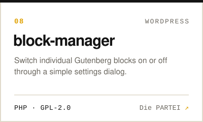</picture></a>
  <a href="https://github.com/Die-PARTEI-in-Europa/EU-Politics-CAPTCHA"><picture><source media="(prefers-color-scheme: dark)" srcset="assets/card-eu-captcha-dark.svg">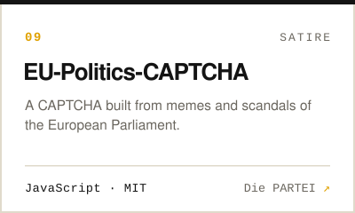</picture></a>
  <a href="https://fuewa.systems/open-source"><picture><source media="(prefers-color-scheme: dark)" srcset="assets/card-more-dark.svg">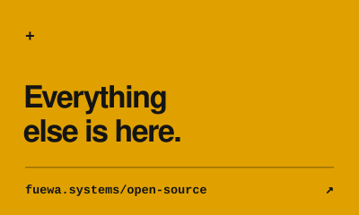</picture></a>

<picture>
  <source media="(prefers-color-scheme: dark)" srcset="assets/s3-toolbox-dark.svg">
  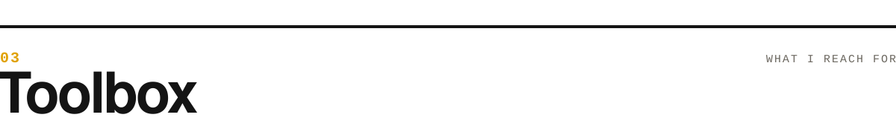
</picture>

<picture>
  <source media="(prefers-color-scheme: dark)" srcset="assets/toolbox-dark.svg">
  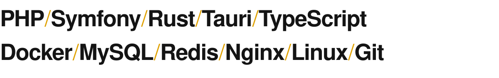
</picture>

<a href="https://fuewa.systems"><picture>
  <source media="(prefers-color-scheme: dark)" srcset="assets/footer-dark.svg">
  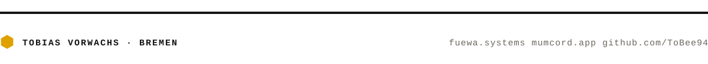
</picture></a>
