<!-- assets/ is generated by scripts/build_assets.py -->

<a href="https://fuewa.systems"><picture><source media="(prefers-color-scheme: dark)" srcset="assets/hero-dark.svg"></picture></a>

<a href="https://github.com/Mumcord/mumcord"><picture><source media="(prefers-color-scheme: dark)" srcset="assets/mumcord-dark.svg"></picture></a>

  
  
  
  &nbsp;<a href="https://mumcord.app"><b>mumcord.app</b></a> · <a href="https://github.com/Mumcord/mumcord/releases/latest"><b>Download</b></a> · <a href="https://github.com/Mumcord/mumcord/wiki"><b>Wiki</b></a>

 

<picture><source media="(prefers-color-scheme: dark)" srcset="assets/os-header-dark.svg"></picture>

<a href="https://github.com/Mumcord/mumbot"><picture><source media="(prefers-color-scheme: dark)" srcset="assets/os-mumbot-dark.svg">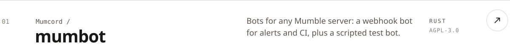</picture></a>
<a href="https://github.com/Mumcord/mumpeer"><picture><source media="(prefers-color-scheme: dark)" srcset="assets/os-mumpeer-dark.svg">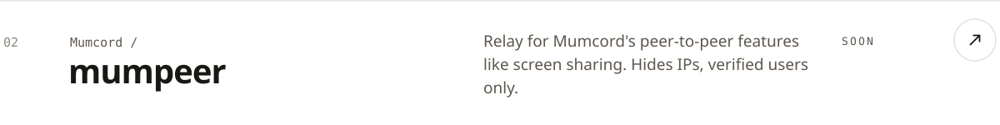</picture></a>
<a href="https://github.com/unserioes24/growdata-hub"><picture><source media="(prefers-color-scheme: dark)" srcset="assets/os-growdata-hub-dark.svg">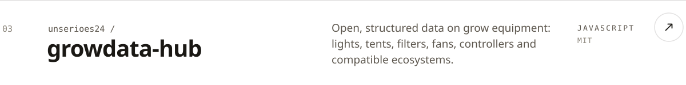</picture></a>
<a href="https://github.com/ToBee94/Shellock"><picture><source media="(prefers-color-scheme: dark)" srcset="assets/os-shellock-dark.svg">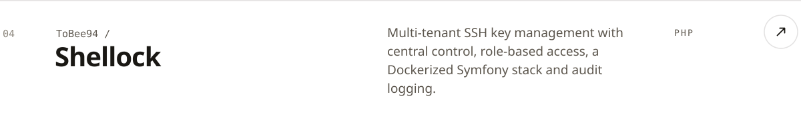</picture></a>
<a href="https://github.com/ToBee94/cloudns-api-php"><picture><source media="(prefers-color-scheme: dark)" srcset="assets/os-cloudns-dark.svg">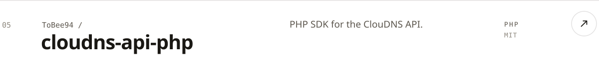</picture></a>
<a href="https://github.com/ToBee94/ac-infinity-php"><picture><source media="(prefers-color-scheme: dark)" srcset="assets/os-acinfinity-dark.svg">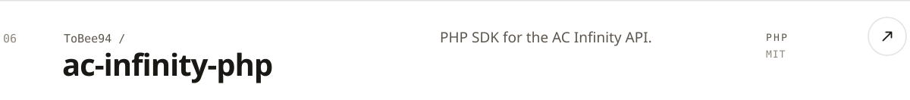</picture></a>
<a href="https://github.com/ToBee94/phpass"><picture><source media="(prefers-color-scheme: dark)" srcset="assets/os-phpass-dark.svg">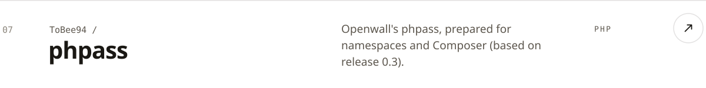</picture></a>
<a href="https://github.com/Die-PARTEI-in-Europa/wordpress-api"><picture><source media="(prefers-color-scheme: dark)" srcset="assets/os-wordpress-api-dark.svg">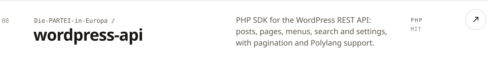</picture></a>
<a href="https://github.com/Die-PARTEI-in-Europa/headless-mode"><picture><source media="(prefers-color-scheme: dark)" srcset="assets/os-headless-mode-dark.svg">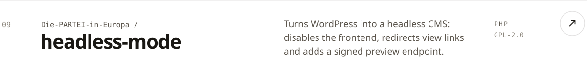</picture></a>
<a href="https://github.com/Die-PARTEI-in-Europa/block-manager"><picture><source media="(prefers-color-scheme: dark)" srcset="assets/os-block-manager-dark.svg">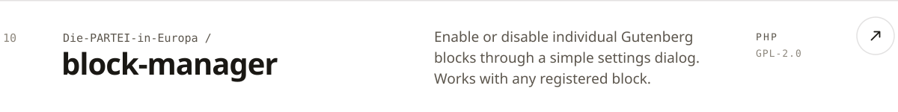</picture></a>
<a href="https://github.com/Die-PARTEI-in-Europa/EU-Politics-CAPTCHA"><picture><source media="(prefers-color-scheme: dark)" srcset="assets/os-eu-captcha-dark.svg">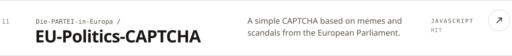</picture></a>

<a href="https://fuewa.systems/open-source">All of it on fuewa.systems/open-source</a>

<picture><source media="(prefers-color-scheme: dark)" srcset="assets/stack-dark.svg"></picture>
  

<a href="https://fuewa.systems"><picture><source media="(prefers-color-scheme: dark)" srcset="assets/cta-dark.svg"></picture></a>
